# Northwind Traders performance analysis

The findings below come from the project report. Metric definitions follow the ten accompanying PostgreSQL queries. Throughout the analysis, **gross sales** means order-line price multiplied by quantity, and **net sales** means that amount after the line discount. Freight is reported separately.

## Q1 · Active products priced from $20 to $50

**Tarte au sucre topped the qualifying list at $49.30.** The report counted **13 products in the $20–$30 range**, showing that this part of the catalogue offered customers several alternatives near the lower end of the selected band.

Among active products priced between $20 and $50, Tarte au sucre had the highest unit price at $49.30 (Figure 2). The lower end of the range offered more choice, with 13 products priced between $20 and $30 and fewer products at higher prices (Figure 3).

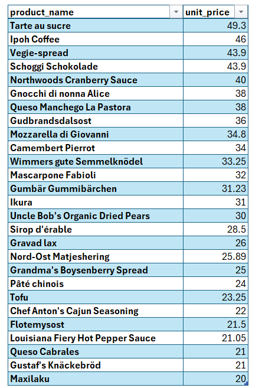

The Product Team can use this list during its annual pricing review to identify which products are available at each price point and assess which could give Northwind a competitive advantage. The Marketing Team can use the same list to select products to promote to customers shopping within a particular price range.

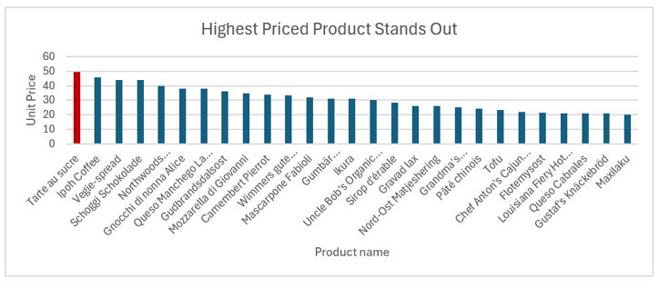

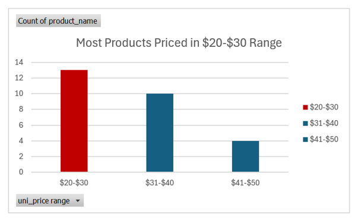

## Q2 · Dispatch time by destination in 1998

**Sweden had the longest average time from order to dispatch among qualifying destinations, at 13.29 days across a group of 14 orders.** Germany recorded 5.38 days with 34 orders. The USA handled 39 orders and averaged 7.89 days, so the longest wait and the largest workload occurred in different markets.

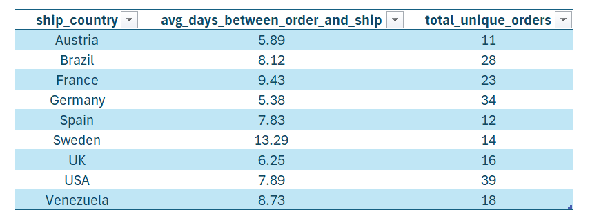

The Logistics Team can use these findings to investigate why orders to Sweden took longer to dispatch and to prioritise improvements in the USA, where shorter processing times would benefit the largest number of orders. Germany provides a useful benchmark because it combined high order volume with relatively fast dispatch.

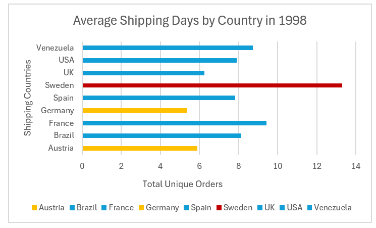

*Figure 5. Average days from order placement to dispatch by country in 1998.*

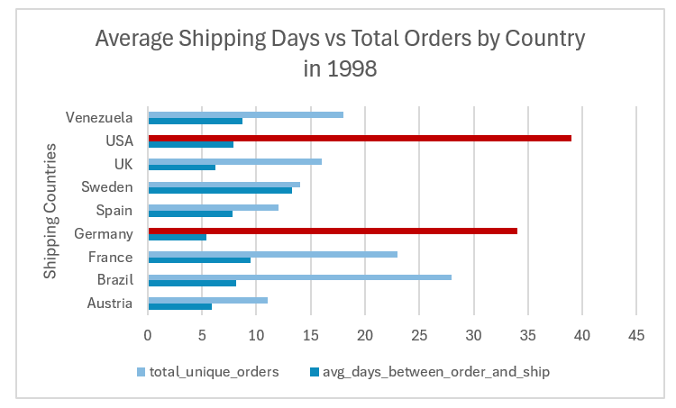

*Figure 6. Average days to dispatch and number of distinct orders by country in 1998.*

## Q3 · Age at hire and reporting relationships

**Anne Dodsworth and Janet Leverling were the youngest hires at 28. Margaret Peacock was the oldest at 55.** The report found that most sales hires clustered between ages 28 and 36. The two extremes were 27 years apart.

The query calculates completed years between birth date and hire date, then matches each employee’s reporting reference to a second copy of the employee table. The left join keeps the top-level employee in the roster even when the manager fields are empty. The result pairs a historical measure, age at hire, with the manager and job titles recorded in the dataset.

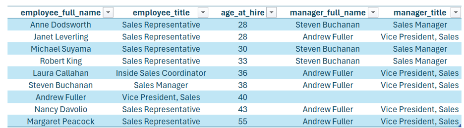

The HR Team can use age at hire to review recruitment patterns and reporting relationships to see how many employees each manager oversees.

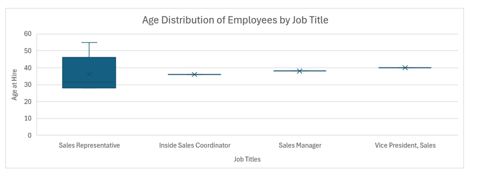

*Figure 8. Distribution of employee ages at hire by job title.*

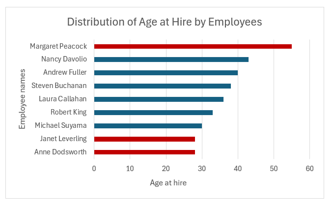

*Figure 9. Age at hire by employee.*

## Q4 · Monthly order volume and freight in 1997–1998

**April 1998 led the qualifying months on both measures, with 74 orders and approximately $6,394 in total freight.** That is about **$86.41 per order**, using the rounded monthly total. March 1998 also stood out for high freight, while September 1997 had the lowest order count and total freight among the months retained.

The query groups by calendar month and removes months with 35 or fewer orders before ranking by total freight. April’s total identifies a period of heavy logistics activity. Comparing freight per order across months would help distinguish higher shipment volume from more expensive shipments. The query displays the month as text, such as `April 1998`, although the brief requested a date such as `1998-04-01`.

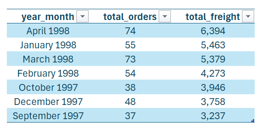

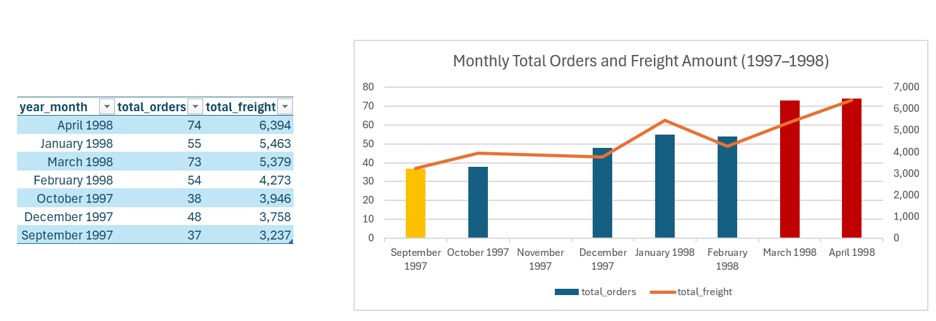

*Figure 11. Monthly order counts and total freight costs for months with more than 35 orders, 1997–1998.*

## Q5 · Products outside the 20–30% price-change band

**Longlife Tofu had the largest reported positive difference in the filtered results, at 14%. Genen Shouyu showed a decrease.** Most reported positive differences clustered between 3% and 9%.

The baseline matters here. The query labels its comparison value `initial_unit_price`, but calculates it as the arithmetic mean of the product’s historical order-line unit prices. Each line contributes equally regardless of quantity or date.

**Reported change (%)** = 100 × (catalogue unit price − mean historical line price) / mean historical line price.

The query filters on the unrounded change and displays a whole percentage. Its lower branch accepts every change below 20%, including zero and negative values. The results therefore identify catalogue prices that differ from historical averages. Answering the brief’s narrower question about actual increases since the first sale would require an earliest dated price and a positive-change filter.

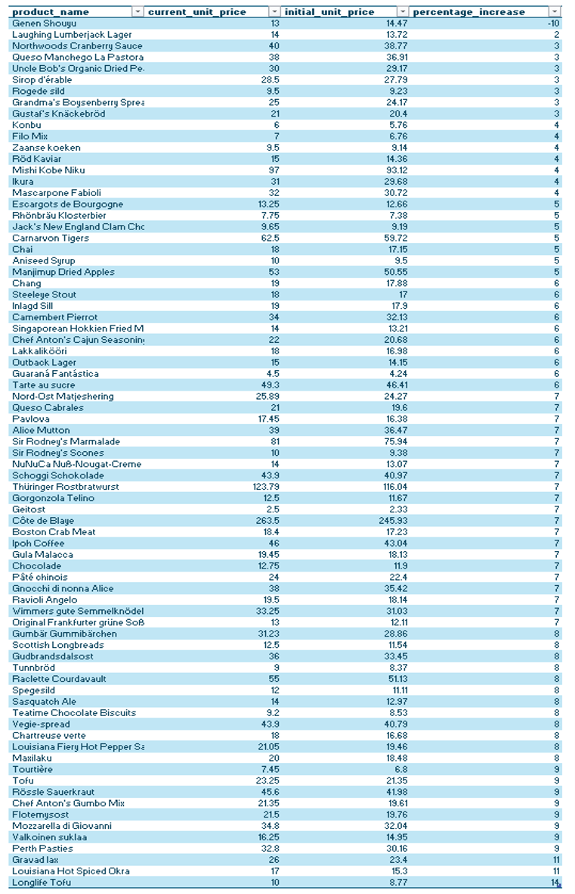

## Q6 · Net sales and order volume by category and price band

**Dairy Products and Beverages stood out for both sales and order volume. Beverages was particularly strong in the over-$50 band.** The middle and upper price bands made substantial contributions to revenue, giving the Pricing Team a way to distinguish categories with broad order reach from those supported by higher-priced products.

| Measure | Calculation |
| --- | --- |
| Price band | Current catalogue unit price below $20, from $20 through $50, or above $50 |
| Net sales | Sum of historical line price × quantity × (1 − discount), displayed in whole dollars |
| Order volume | Distinct order IDs containing at least one product in that category and band |

An order containing a $15 item and a $40 item in the same category counts once in each band. Sales amounts can be added across bands before rounding, but adding the order counts can count the same order twice.

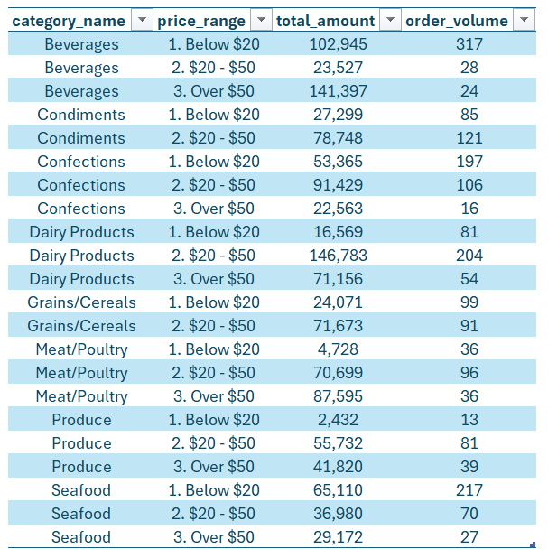

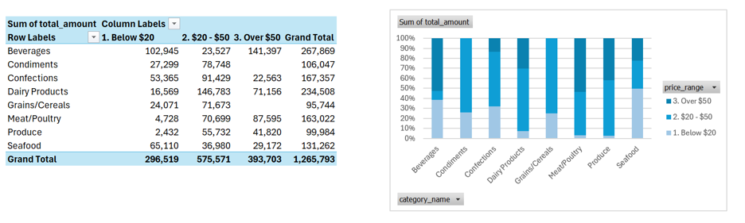

*Figure 16. Total sales after discounts by product category and price range.*

## Q7 · Stock and replenishment by supplier region

**Seafood, Beverages and Condiments stood out for stock on hand. Condiments and Confections also had substantial quantities on order.** Within Confections, Europe had the highest stock and the highest combined reorder level. The report identified Meat/Poultry and Produce at the lower end for stock and reorder levels.

| Inventory measure | Meaning for Logistics |
| --- | --- |
| Units in stock | Units currently held across the products in the group |
| Units on order | Incoming replenishment quantity |
| Total reorder level | Sum of the individual products’ reorder thresholds |

The SQL assigns selected supplier countries to America, Europe or Asia-Pacific and places every unmatched country in **Other**. The regional totals depend on this mapping. A category total can also hide a low-stock product alongside a well-stocked one. Replenishment decisions require comparing each product’s available and incoming units with its own threshold.

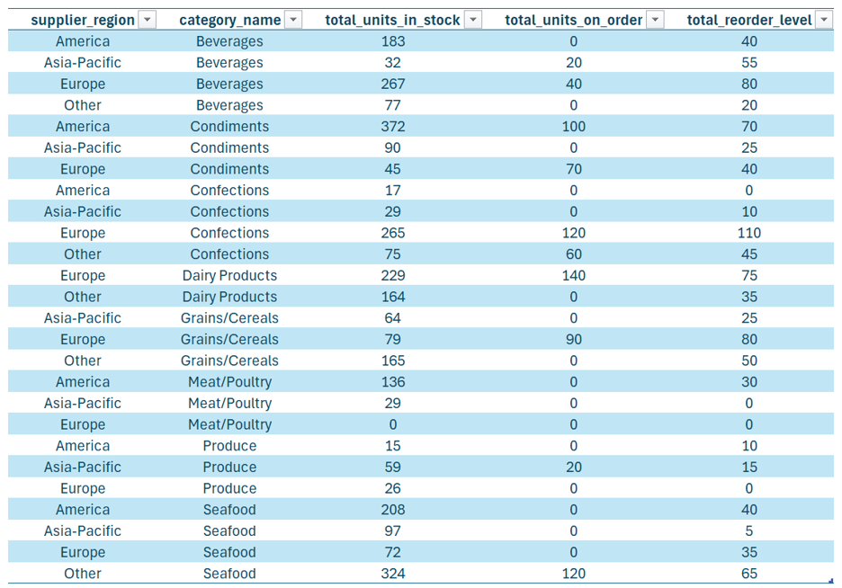

## Q8 · Active product prices against category benchmarks

**Seafood and Confections had roughly balanced counts of active products above and below their category medians.** The report also highlighted Dairy Products in the above-average comparison. Each benchmark is calculated inside its own category, so an above-average dairy price describes its position among other active dairy products.

The query uses the arithmetic mean and the continuous 50th percentile of active catalogue prices. It rounds each benchmark to two decimals before assigning each product a below, equal or over label. Products with discontinued status are excluded from both the benchmarks and the output.

The median comparison indicates where a product falls in the ordered assortment. Roughly equal counts on either side are expected and give no measure of how far apart the prices are. For a pricing review, the actual dollar distance from each benchmark is more informative than the label alone.

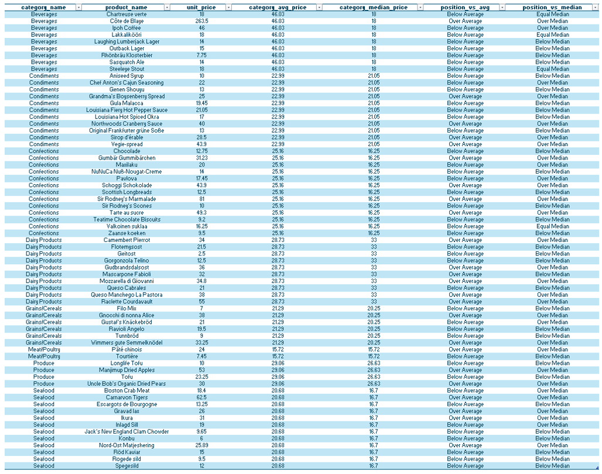

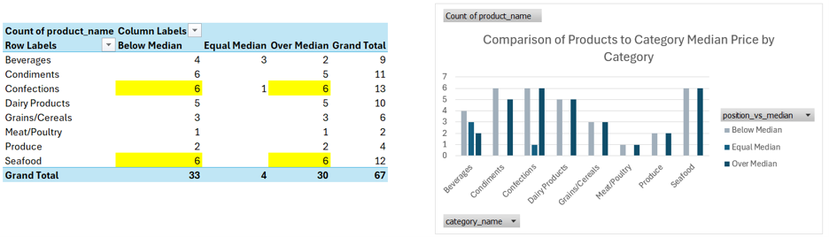

*Figure 21. Active product counts by category and price relative to the category median.*

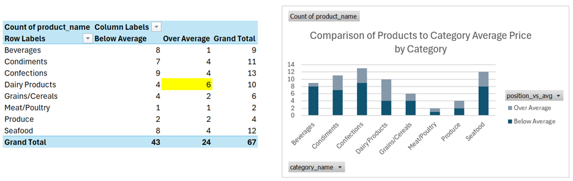

*Figure 22. Active product counts by category and price relative to the category average.*

## Q9 · Employee sales, order value and discounts

**Margaret Peacock and Janet Leverling stood out for sales and order volume. Steven Buchanan had the lowest reported net sales.** The report also highlighted Robert King for discounting and relatively high product amounts. The SQL’s product-amount metric includes quantity, so a large line can reflect more units sold as well as a higher unit price.

| Returned measure | Interpretation |
| --- | --- |
| Gross sales | Sum of order-line price × quantity |
| Unique orders | Distinct customer order IDs credited to the employee |
| Total orders | Count of order-detail rows, so a multi-product order contributes multiple rows |
| Average product amount | Average gross value per order line |
| Average order amount | Gross sales divided by distinct orders |
| Total discount | Sum of gross line value × line discount |
| Net sales | Gross sales less total discount, used for the ranking |
| Discount percentage | Total discount divided by **net sales**, multiplied by 100 |

These measures explain different routes to a high sales total. Unique orders capture volume, average order amount captures basket value, and the discount amount shows how much gross value was given up. The percentage uses net sales as its denominator, so it will differ from a discount rate expressed as a share of gross sales.

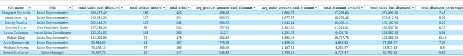

## Q10 · Employee contributions by product category

**Beverages generated the highest overall net sales, and Margaret Peacock led employee sales within Beverages.** The report also highlighted Anne Dodsworth in Produce and Steven Buchanan for the prominence of Dairy Products in his own sales mix.

| Share | Denominator | Business question answered |
| --- | --- | --- |
| Share of employee sales | The employee’s net sales across all categories | How much of this employee’s business came from this category? |
| Share of company sales | Net sales across all employees and categories | How much did this employee–category combination contribute to Northwind’s sales? |

Both shares use the same numerator, the employee’s net sales in the category. The SQL returns fractions rounded to five decimals. For example, a displayed value of 0.25000 means 25%. Sorting by net sales within category identifies its leading sellers. Reading across an employee’s category shares reveals their sales mix, which can highlight a specialisation even when another employee sells more dollars in that category.

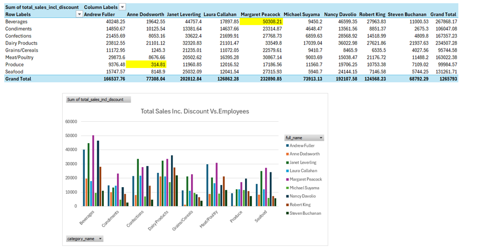
